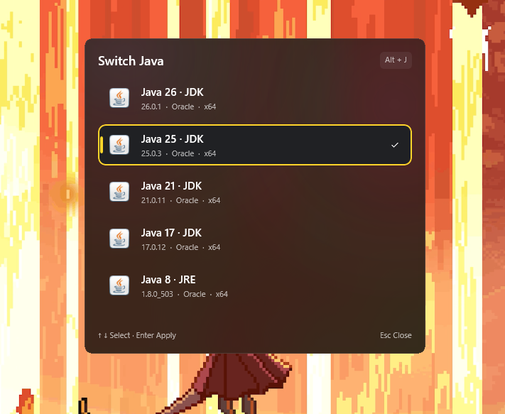
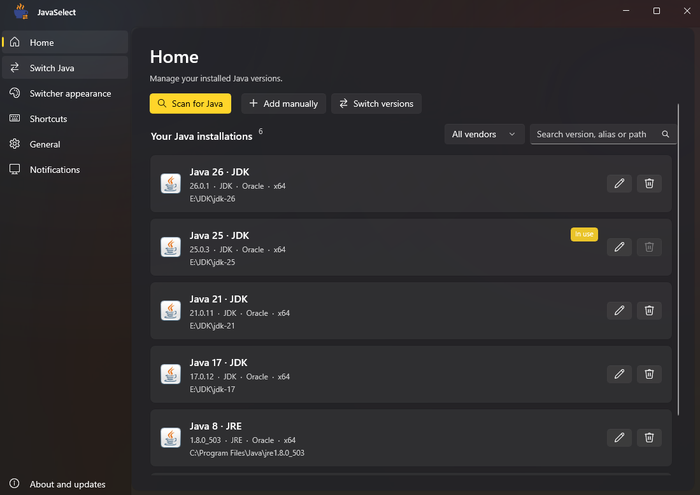
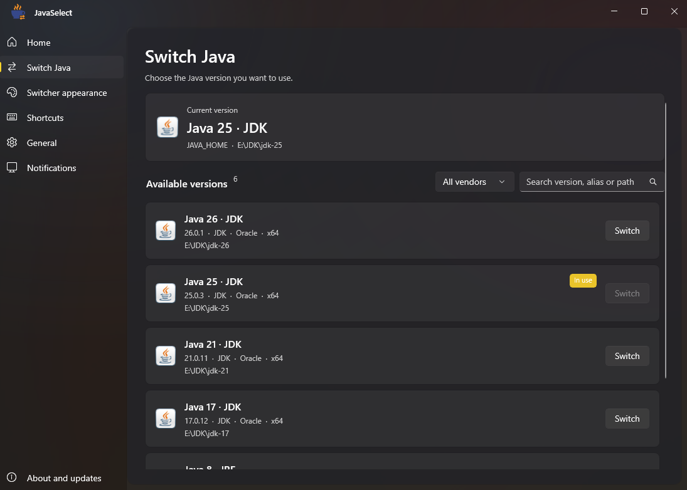
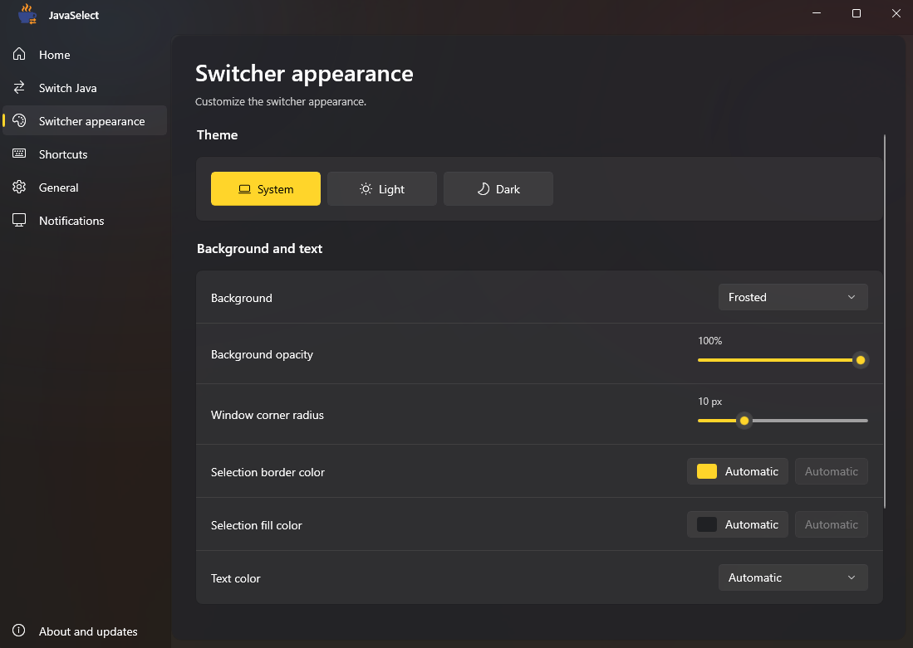
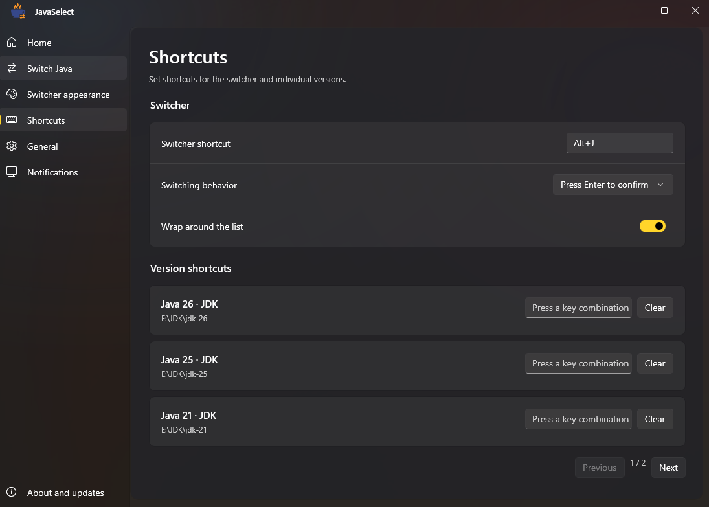

[简体中文](README.md) · [繁體中文](README.zh-TW.md) · [English](README.en.md) · [日本語](README.ja.md)

# JavaSelect

A Java version manager for Windows. Switch between installed JDKs and JREs with a keyboard shortcut.

## Screenshots

More screenshots

**Home**

**Switch Java**

**Appearance**

**Shortcuts**

**Custom launcher example (Simplified Chinese interface)**

## Download

[Releases](https://github.com/xiaoranawa/javaselect/releases) · [Development builds](https://github.com/xiaoranawa/javaselect/actions/workflows/release.yml)

- **Installer**: download `*-setup.exe`. Supports upgrading an existing installation and requires the .NET 10 Runtime (x64); Setup prompts you to download it if missing.
- **Portable**: download `*-portable.zip`, extract the entire folder, and run `JavaSelect.exe`.

For development builds, open a successful Actions run and download its **Artifacts**. Requires **Windows 10 version 2004 or later, or Windows 11 (x64)**.

## Features

- Scan for Java or add it manually, with aliases, search, vendor filters, and per-version launcher visibility.
- Sort the version list automatically (newest first, oldest first, or by name) or manually with move up / move down buttons. The home page, launcher, and shortcut page share one order.
- Open the always-on-top launcher with a global shortcut, **Alt+J** by default and customizable in settings, or assign shortcuts to individual versions.
- System, light, and dark themes with custom backgrounds, opacity, and rounded corners. Selection border and fill colors are independently configurable and default to automatic; text backgrounds and image blur are off by default.
- Reset the default appearance while keeping your Java list, shortcuts, and other settings.
- Restore the last selected Java, receive Windows notifications, check GitHub updates, and upgrade the installed edition.

## Quick start

1. Open JavaSelect and scan for Java, or manually add an installation folder.
2. Press your configured global shortcut (**Alt+J** by default), choose a version with **↑ / ↓**, then press **Enter**. You can also click a version.
3. Open a new terminal to use the selected Java.

Closing the main window keeps JavaSelect in the system tray by default. Shortcuts remain active until you quit the app from the tray. You can turn on Launch at sign-in in the installer or under General in settings; it starts through Task Scheduler with administrator rights, so Windows shows no UAC prompt at sign-in. On first launch, the app follows your system language; Simplified Chinese, Traditional Chinese, English, and Japanese are available in settings.

See the [detailed guide (Chinese)](docs/guide.zh-CN.md) for configuration, environment variables, and local builds.

## About

Built with C#, .NET 10, and native WinUI 3. Licensed under [MIT](LICENSE).

If JavaSelect helps you, leave a Star ⭐ QWQ
