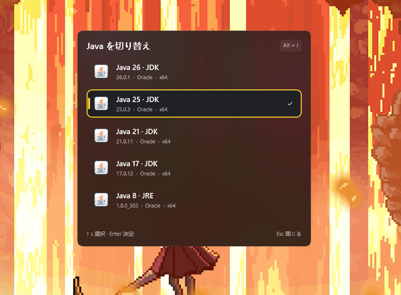
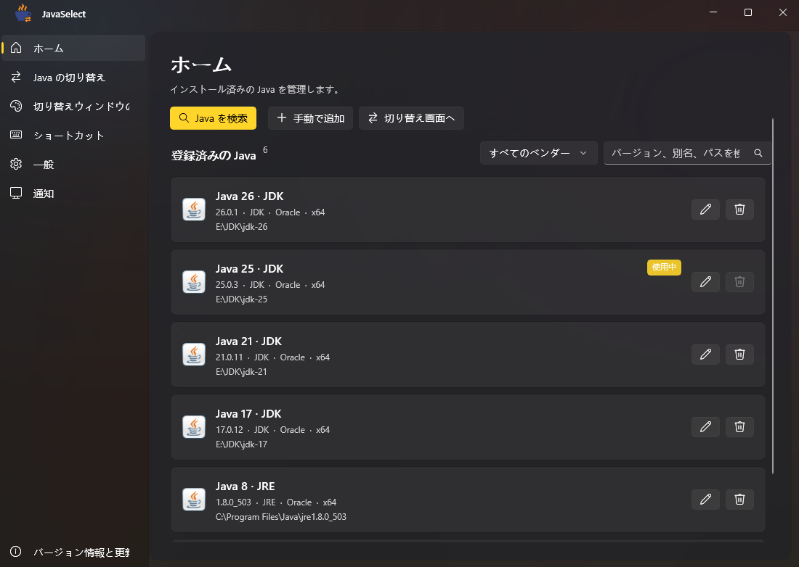
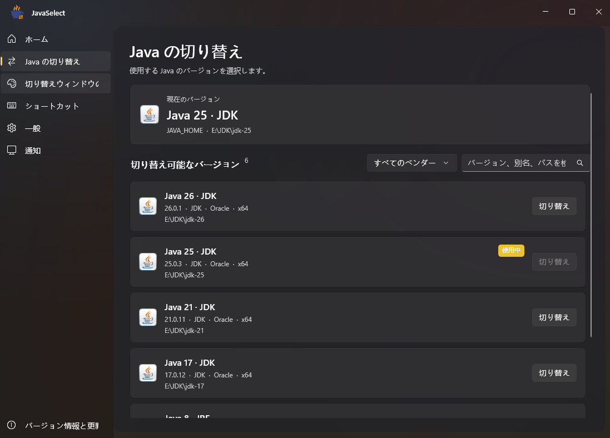
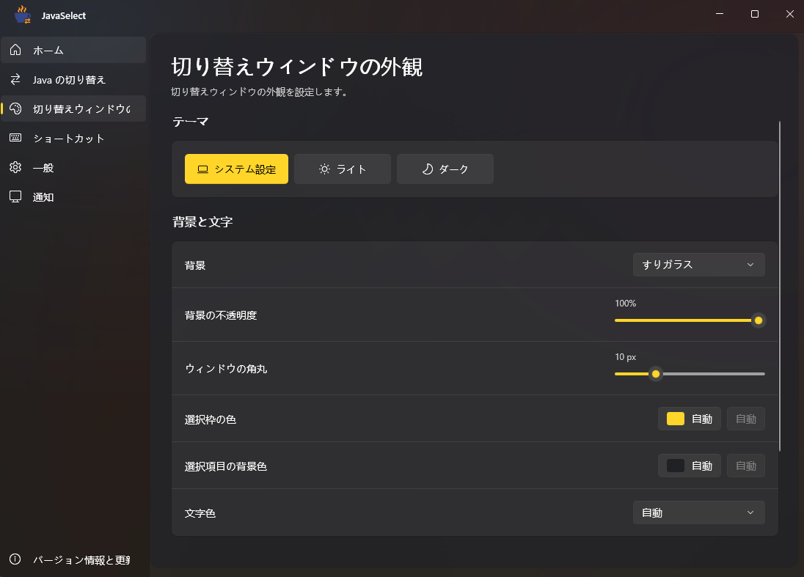
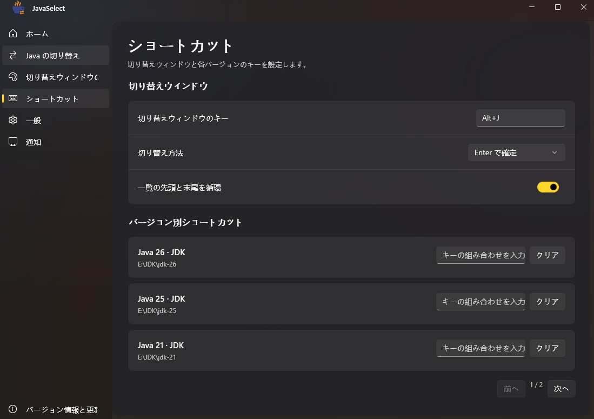

[简体中文](README.md) · [繁體中文](README.zh-TW.md) · [English](README.en.md) · [日本語](README.ja.md)

# JavaSelect

Windows 向けの Java バージョン管理ツールです。複数の Java をすばやく切り替えられます。C#、.NET 10、ネイティブの WinUI 3 を使用し、Fluent Design に沿った UI を採用しています。

## スクリーンショット

その他のスクリーンショット

**ホーム**

**Java の切り替え**

**外観**

**ショートカットキー**

**カスタマイズ例（簡体字中国語の画面）**

## ダウンロード

Windows 10 バージョン 2004（19041）以降および Windows 11 の x64 環境に対応しています。

- [正式リリース](https://github.com/xiaoranawa/javaselect/releases)：Releases からダウンロードできます。
- [開発ビルド](https://github.com/xiaoranawa/javaselect/actions/workflows/release.yml)：Actions で成功した実行を開き、**Artifacts** からダウンロードしてください。

`*-setup.exe` でインストールするか、`*-portable.zip` をすべて展開して `JavaSelect.exe` を実行してください。インストール版には .NET 10 ランタイム（x64）が必要で、未インストールの場合は案内が表示されます。ポータブル版はフォルダー全体を保持し、EXE だけをコピーしないでください。

## 使い方

1. 自動スキャンで Java を探すか、インストール先を手動で指定し、スキャンして確認後に追加します。
2. グローバルショートカットキー（既定は **Alt+J**、設定で変更可能）で切り替えウィンドウを開き、**↑ / ↓** で選択して **Enter** で確定します。バージョンを直接クリックしても切り替えられます。
3. 切り替え後はターミナルを閉じて開き直し、新しい環境変数を反映してください。

メインウィンドウを閉じると、既定ではタスクトレイに常駐します。トレイからアプリを終了すると、ショートカットキーも無効になります。「サインイン時に起動」はインストーラー、または設定の「一般」で有効にできます。タスク スケジューラ経由で管理者権限で起動するため、サインイン時に UAC は表示されません。

## 主な機能

- 複数の JDK / JRE の管理、検索、ベンダーによる絞り込み、別名の設定、切り替えウィンドウでの非表示。
- バージョン一覧は自動（新しい順・古い順・名前順）または手動（上へ／下へボタン）で並べ替えできます。ホーム、切り替えウィンドウ、ショートカット画面は同じ順序で表示されます。
- グローバルショートカットキーと、バージョンごとのショートカットキー。
- システム連動・ライト・ダークのテーマと、背景・透明度・角丸の調整。選択枠の線と塗りつぶしの色は個別に設定でき、既定は自動です。文字の背景と画像のぼかしは既定でオフです。
- 外観を既定に戻しても、Java の一覧やショートカットキーなどの設定は保持されます。
- 前回選択した環境の自動復元、Windows 通知、インストール版の更新。

初回起動時はシステム言語に合わせて簡体字中国語・繁体字中国語・英語・日本語を選択します。後から手動で変更できます。

詳しい使い方とビルド手順は[詳細ガイド（簡体字中国語）](docs/guide.zh-CN.md)をご覧ください。

[MIT ライセンス](LICENSE)
