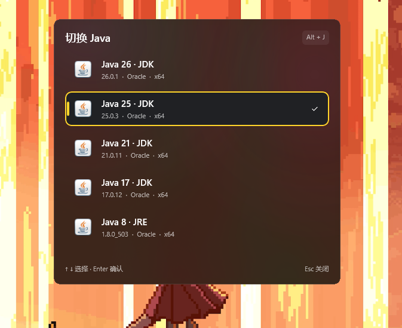
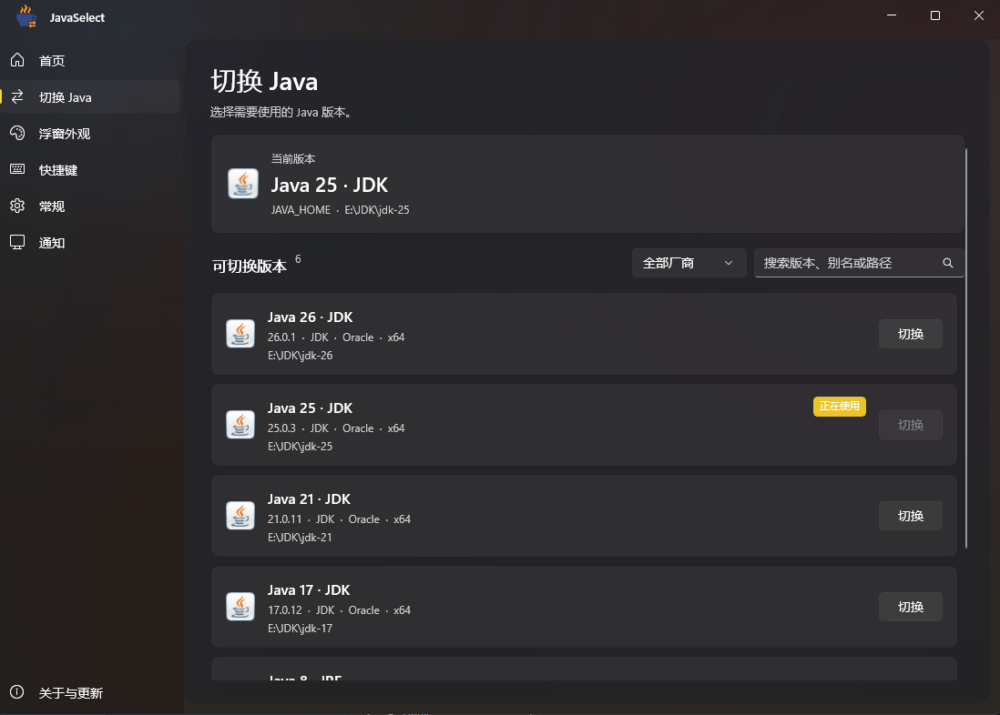
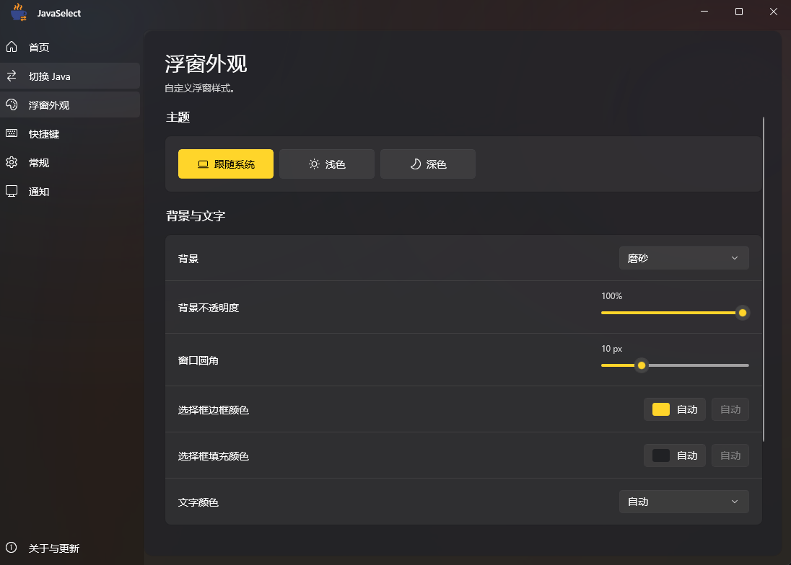
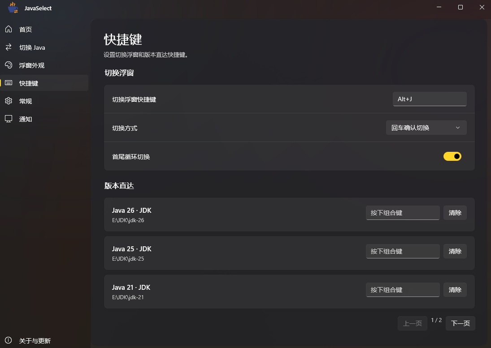

[简体中文](README.md) · [繁體中文](README.zh-TW.md) · [English](README.en.md) · [日本語](README.ja.md)

# JavaSelect

一款适用于 Windows 的 Java 版本管理工具，用快捷键在多个 JDK / JRE 之间轻松切换。

## 界面预览

查看更多截图

**切换 Java**

**浮窗外观**

**快捷键**

**自定义浮窗示例**

## 下载

[正式版本](https://github.com/xiaoranawa/javaselect/releases) · [开发构建](https://github.com/xiaoranawa/javaselect/actions/workflows/release.yml)

- **安装版**：下载 `*-setup.exe`，支持覆盖升级；需要 .NET 10 运行时（x64），缺少时会提示下载。
- **免安装版**：下载 `*-portable.zip`，完整解压后运行 `JavaSelect.exe`。

开发构建可在 Actions 中打开成功的运行记录，从 **Artifacts** 下载。支持 **Windows 10 2004 及以上版本、Windows 11（x64）**。

## 主要功能

- 自动扫描或手动添加 Java，支持别名、搜索、厂商筛选，以及隐藏浮窗中的版本。
- 版本列表支持自动排序（版本从新到旧、从旧到新、按名称）和手动排序（用上移 / 下移按钮调整），主页、浮窗与快捷键页的顺序保持一致。
- 用全局快捷键呼出置顶浮窗，默认 **Alt+J**，可在设置中自定义；也可为指定版本设置快捷键。
- 浮窗默认出现在鼠标所在的屏幕，也可改为当前窗口所在的屏幕、主屏幕或指定的屏幕。
- 跟随系统、浅色和深色主题，自定义背景、不透明度与圆角；选择框边框和填充颜色可分别设置，默认自动。文字背景与图片模糊默认关闭。
- “恢复默认外观”仅重置外观，保留 Java 列表、快捷键等配置。
- 恢复上次选择的 Java、系统通知、GitHub 更新检查与安装版覆盖升级。

## 快速开始

1. 打开 JavaSelect，选择“自动扫描”或“手动添加”Java 安装目录。
2. 按设置的全局快捷键（默认 **Alt+J**），用 **↑ / ↓** 选择版本，按 **Enter** 确认，也可直接点击版本。
3. 重新打开终端，使用切换后的 Java。

关闭主窗口默认收起到托盘，快捷键仍可使用；从托盘退出软件后，快捷键停止。可在安装程序中勾选，或在“常规”设置中开启“开机自启动”：通过任务计划程序以管理员权限启动，开机时不会弹出 UAC 提示。首次启动会跟随系统语言，也可手动选择简体中文、繁體中文、English 或日本語。

更多配置、环境变量说明和本地构建方法见[详细指南](docs/guide.zh-CN.md)。

## 关于

使用 C#、.NET 10 和原生 WinUI 3，采用 [MIT 许可证](LICENSE)。

如果觉得好用，就给个 Star ⭐ 吧 QWQ
