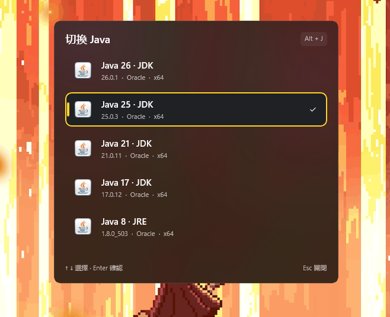
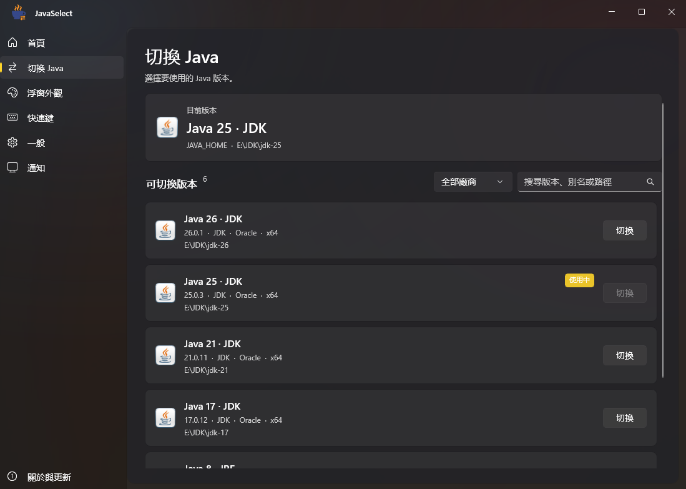
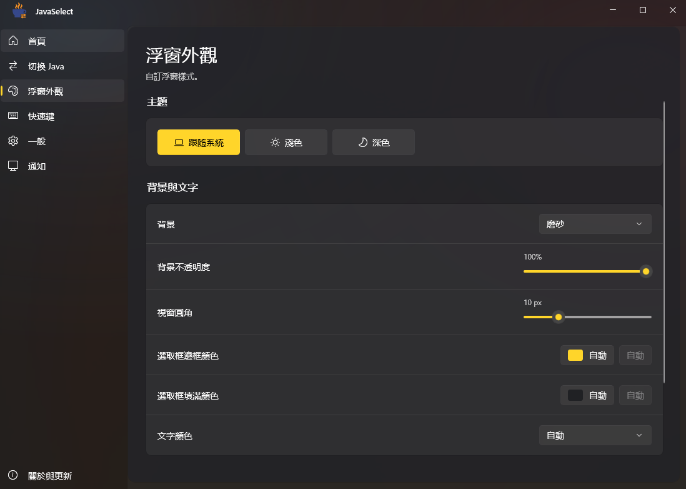
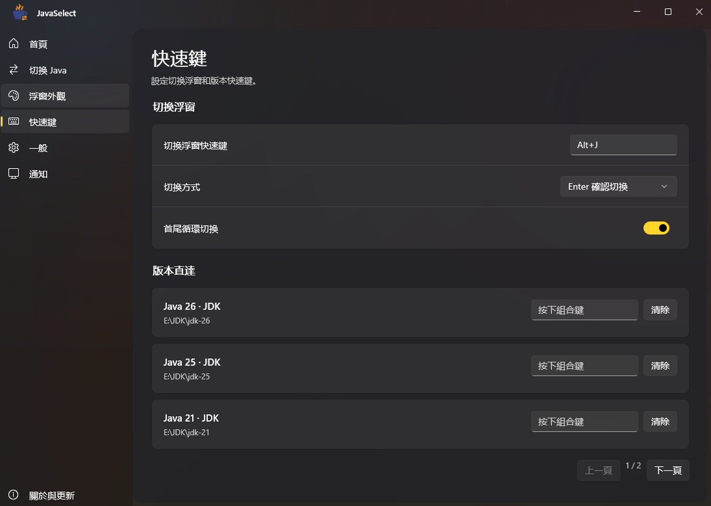
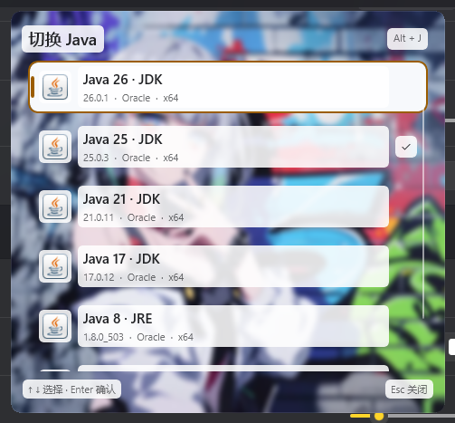

[简体中文](README.md) · [繁體中文](README.zh-TW.md) · [English](README.en.md) · [日本語](README.ja.md)

# JavaSelect

一款適用於 Windows 的 Java 版本管理工具，快速切換不同版本。以 C#、.NET 10 與原生 WinUI 3 打造，採用 Fluent Design 介面。

## 介面預覽

查看更多截圖

**切換 Java**

**浮窗外觀**

**快捷鍵**

**自訂浮窗範例（簡體中文介面）**

## 下載

支援 Windows 10 2004（19041）以上版本與 Windows 11，限 x64。

- [正式版本](https://github.com/xiaoranawa/javaselect/releases)：在 Releases 下載。
- [開發版本](https://github.com/xiaoranawa/javaselect/actions/workflows/release.yml)：進入 Actions 的成功執行紀錄，在 **Artifacts** 下載。

選擇 `*-setup.exe` 安裝，或完整解壓縮 `*-portable.zip` 後執行 `JavaSelect.exe`。安裝版需要 .NET 10 執行階段（x64），缺少時會提示下載；免安裝版請保留整個資料夾，不要只複製 EXE。

## 開始使用

1. 選擇「自動掃描」，或手動加入安裝目錄，掃描確認後加入版本。
2. 按全域快捷鍵（預設為 **Alt+J**，可在設定中自訂）開啟浮動視窗，以 **↑ / ↓** 選擇，再按 **Enter** 確認；也可直接點選版本。
3. 切換後，關閉並重新開啟終端機，讓新的環境變數生效。

關閉主視窗預設會縮至系統匣，快捷鍵仍可使用；從系統匣結束程式後，快捷鍵也會停止。可在安裝程式中勾選，或於「一般」設定開啟「開機自動啟動」：透過工作排程器以系統管理員權限啟動，開機時不會跳出 UAC 提示。

## 功能

- 管理多個 JDK / JRE，支援搜尋、廠商篩選、別名與隱藏浮窗中的版本。
- 版本清單支援自動排序（版本由新到舊、由舊到新、依名稱）與手動排序（以上移 / 下移按鈕調整），首頁、浮窗與快捷鍵頁的順序保持一致。
- 全域切換快捷鍵，以及各版本的專屬快捷鍵。
- 浮窗預設出現在滑鼠所在的螢幕，也可改為目前視窗所在的螢幕、主螢幕或指定的螢幕。
- 跟隨系統、淺色與深色主題，自訂背景、透明度及圓角；選取框邊框與填滿顏色可分別設定，預設為自動。文字背景與圖片模糊預設關閉。
- 還原預設外觀只重設外觀，保留 Java 清單、快捷鍵等設定。
- 自動還原上次選擇的環境、Windows 系統通知與安裝版更新。

首次啟動會依系統語言選擇簡體中文、繁體中文、英文或日文，之後可手動調整。

更多用法與建置說明請見[詳細文件（簡體中文）](docs/guide.zh-CN.md)。

[MIT 授權條款](LICENSE)
